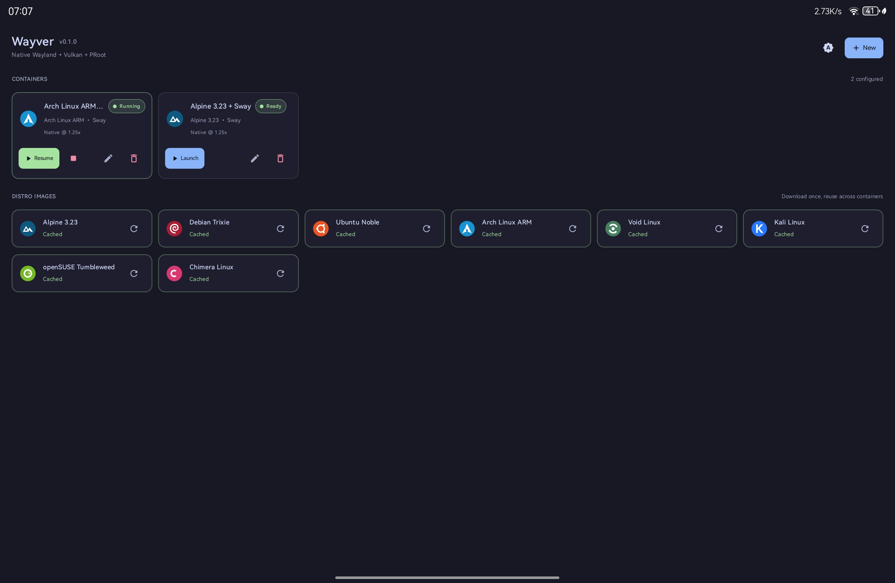
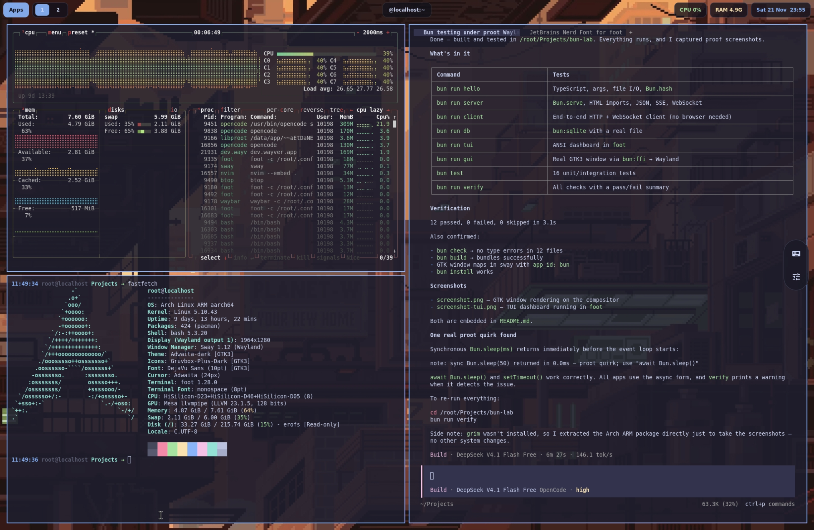
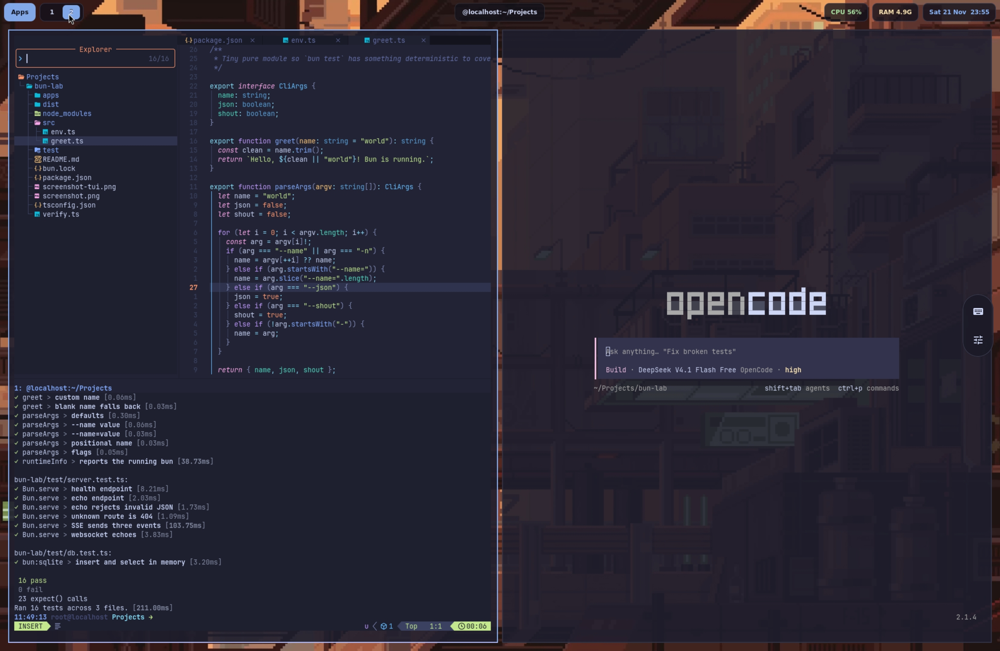
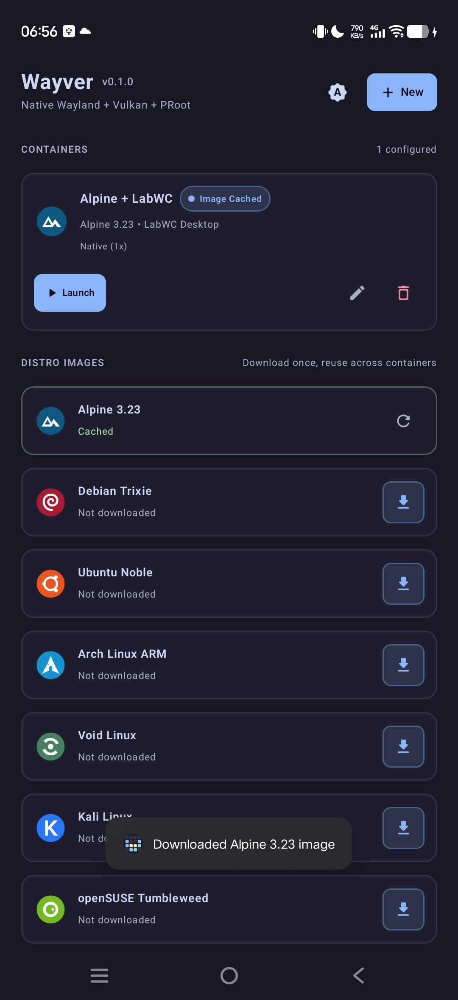
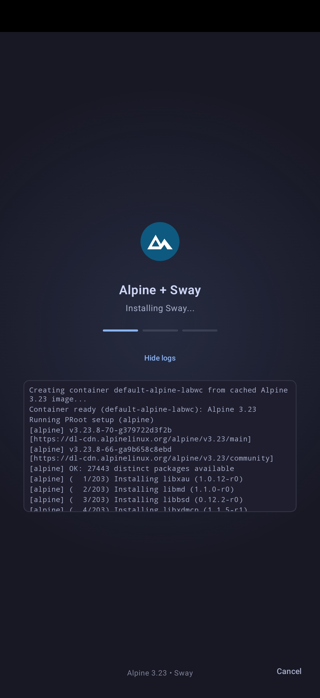
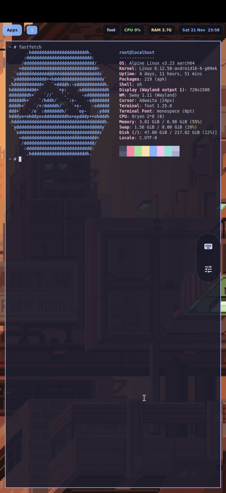

<p align="center">
  
</p>

<h1 align="center">Wayver</h1>

<p align="center">
  <strong>Run real Linux desktops on your Android phone or tablet — no root, no VNC</strong>
</p>

Wayver runs Linux distributions inside an isolated container and renders their Wayland desktops directly onto your Android screen with native touch, keyboard, audio, and two-way clipboard sync.

> [!NOTE]
> **Early Development**
> Wayver is usable today for terminal work, coding tools, and lightweight desktops, but it is still in active development:
>
> - **Runs as simulated root (`proot -0`)**: Containers run as fake `root` inside the sandbox for package-manager compatibility; unprivileged multi-user isolation is not implemented yet.
> - **Mostly stock distro configs**: Desktops currently use lightweight, minimal configurations rather than heavily customized themes.
> - **Software rendering only**: Graphics currently render on the CPU (`pixman` / `llvmpipe`); hardware-accelerated guest GPU support is planned for a future release.

---

## Screenshots

<p align="center">
  
  
</p>
<p align="center">
  
</p>
<p align="center">
  
  
  
</p>

---

## What You Can Do

- **Pick from 8 Linux distros** — download once and reuse the image across multiple containers, or import your own `.tar`, `.tar.gz`, or `.tar.xz` rootfs archive.
- **Run full desktops or just a terminal** — switch between tiling WMs (`Sway`, `River`), classic desktops (`XFCE`, `LXQt`, `LabWC`), mobile shell (`Phosh`), or standalone `Foot Terminal` without losing your files.
- **Copy & paste seamlessly** — two-way clipboard sync between Android and Linux apps (both standalone terminals and nested desktops).
- **Sound out of the box** — Linux audio streams directly to Android speakers/headphones.
- **Multitask easily** — run multiple containers, switch via the Quick Menu pill on the right edge of the screen, or jump back from the Android notification.
- **Fit any screen** — choose `Native (1x)` up to `Native @ 2x` (or `0.5x` / `0.75x`) for comfortable text size on phones and tablets.

---

## Supported Distros & Desktops

| Distro                  | Available Desktops                                                            |
| :---------------------- | :---------------------------------------------------------------------------- |
| **Alpine 3.23**         | `LabWC`, `Sway`, `XFCE (Wayland)`, `LXQt (Wayland)`, `River`, `Foot Terminal` |
| **Arch Linux ARM**      | `LabWC`, `Sway`, `XFCE (Wayland)`, `LXQt (Wayland)`, `River`, `Foot Terminal` |
| **Void Linux**          | `LabWC`, `Sway`, `XFCE (Wayland)`, `LXQt (Wayland)`, `River`, `Foot Terminal` |
| **openSUSE Tumbleweed** | `LabWC`, `Sway`, `XFCE (Wayland)`, `LXQt (Wayland)`, `Foot Terminal`          |
| **Chimera Linux**       | `LabWC`, `Sway`, `XFCE (Wayland)`, `Foot Terminal`                            |
| **Debian Trixie**       | `LabWC`, `XFCE (Wayland)`, `Phosh (Mobile)`, `Foot Terminal`                  |
| **Kali Linux**          | `LabWC`, `XFCE (Wayland)`, `Foot Terminal`                                    |
| **Ubuntu Noble**        | `LabWC`, `Foot Terminal`                                                      |

---

## Quick Start

1. **Install the APK** from [Releases](../../releases) (`arm64-v8a`, Android 8.0+ / API 26+).
2. **Download a Distro Image** from the home screen (or tap **+ New** to create a container).
3. **Choose a Desktop** (e.g. `Sway`, `LabWC`, `XFCE`, or `Foot Terminal`) and tap **Launch**.
4. **Wait for First-Time Setup** — Wayver extracts the rootfs and installs your desktop packages automatically.
5. **Use the Right-Edge Pill** during a session to toggle the keyboard, switch containers, view logs, or restart/stop.

---

### Architecture

```text
┌─────────────────────────────────────────────────────────────────────────┐
│ Android App (Kotlin + Jetpack Compose)                                  │
│  ├─ LauncherScreen ── Container/Image management, theme & env editor    │
│  ├─ DisplayActivity ─ SurfaceView, input forwarding, Setup & Quick Menu │
│  └─ ContainerNotificationService ─ Foreground service (Open / Kill)     │
├─────────────────────────────────────────────────────────────────────────┤
│ Rust Native Engine (libwayver.so via JNI)                               │
│  ├─ wl_server    ── Wayland compositor (wl_shm, xdg_shell, wl_seat...)  │
│  ├─ clipboard    ── Two-way Android <-> Wayland & nested DE sync        │
│  ├─ vk_presenter ── Vulkan swapchain (MAILBOX, vkCmdCopyImage 1:1)      │
│  └─ audio        ── PulseAudio native socket server -> Android AAudio    │
├─────────────────────────────────────────────────────────────────────────┤
│ PRoot Guest Containers (files/containers/<id>/rootfs)                   │
│  └─ LabWC / Sway / XFCE / LXQt / River / Phosh / Foot -> wayland-0      │
└─────────────────────────────────────────────────────────────────────────┘
```

### Project Structure

```text
app/src/main/
├── assets/
│   ├── distros/{alpine,arch,chimera,debian,kali,opensuse,ubuntu,void}/  # Isolated per-DE configs
│   └── wallpaper.jpg                          # Default desktop wallpaper
├── java/dev/wayver/app/
│   ├── container/                             # ContainerConfig, ContainerStore, ContainerManager, EnvConfig
│   ├── core/                                  # AppPrefs, NativeBridge, ContainerNotificationService
│   ├── distro/                                # Distro specs, RootfsManager, ProotRunner, ProcSysBindings
│   ├── driver/                                # DriverManager (.zip ICD importer)
│   ├── input/                                 # KeyMapper (Android KeyEvent -> Linux evdev)
│   ├── ui/                                    # Compose Theme, Launcher, Display, Setup & Quick Menu
│   └── utils/                                 # AssetCopy, ContainerLogger, HttpDownloader, TarExtractor
├── jniLibs/arm64-v8a/                         # libproot.so, libproot-loader.so, libwayland-server.so, libffi.so
├── res/                                       # Adaptive launcher icon & distro vector icons
└── rust/src/                                  # Rust native library (libwayver.so)
    ├── audio/                                 # pulse_audio.rs, aaudio_sink.rs
    ├── clipboard/                             # mod.rs, server.rs, bridge.rs
    ├── vk_presenter/                          # Vulkan context, commands, swapchain presenter
    └── wl_server/                             # Wayland protocols, shm, state, present_worker
```

### Build & Tooling

Requirements:

- Android SDK (API 34, `minSdk` 26)
- Android NDK `27.2.12479018`
- Rust toolchain with `aarch64-linux-android` target
- JDK 17+

```bash
# Build debug APK (automatically builds libwayver.so via Cargo)
./gradlew assembleDebug

# Kotlin formatting & linting (ktlint)
./gradlew ktlintFormat
./gradlew ktlintCheck

# Install onto a connected device
adb install -r app/build/outputs/apk/debug/app-debug.apk
```
