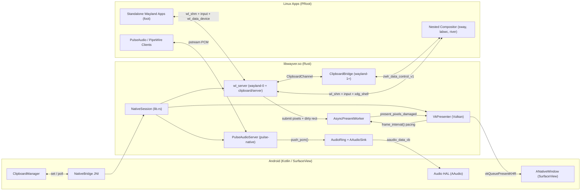

# `wayver` Native Core (Rust)

Native Android library (`libwayver.so`) providing the embedded **Wayland compositor** (`wl_server`), **Vulkan swapchain presenter** (`vk_presenter`), and **PulseAudio → AAudio audio bridge** (`audio`).

---

## Module Layout

```text
src/
├── lib.rs                      # JNI entrypoints (NativeBridge) and NativeSession lifecycle
├── vk_presenter/
│   ├── mod.rs                  # VkPresenter public API, refresh pacing, frame-slot orchestration
│   ├── context.rs              # VkCore, VulkanContext, swapchain, staging/upload memory
│   └── commands.rs             # Dirty-rect staging copy, barriers, copy/blit, queue submit
├── wl_server/
│   ├── mod.rs                  # WlCompositorServer API, DisplayControl, InputEvent, SharedMetrics, wakeup pipe
│   ├── state.rs                # CompositorState, SurfaceData, run_event_loop, handle_surface_commit
│   ├── present_worker.rs       # AsyncPresentWorker (dirty-row coalescing + refresh-paced callbacks)
│   ├── shm.rs                  # wl_shm / wl_shm_pool / wl_buffer mmap management
│   └── protocols.rs            # Wayland globals & Dispatch handlers (xdg_shell, seat, output, etc.)
├── clipboard/
│   ├── mod.rs                  # ClipboardChannel (to_server, to_bridge, from_guest)
│   ├── server.rs               # wl_data_device_manager v3 server on wayland-0 (standalone clients)
│   └── bridge.rs               # ClipboardBridge (zwlr_data_control_manager_v1 client for wayland-1+)
└── audio/
    ├── mod.rs                  # Audio module exports
    ├── pulse_audio.rs          # PulseAudio native protocol v35 server on $XDG_RUNTIME_DIR/pulse-native
    └── aaudio_sink.rs          # 200 ms AudioRing + Android AAudio output stream callback
```

---

## High-Level Architecture



---

## 1. Session Lifecycle & Android Events (`lib.rs`)

Kotlin interacts with Rust exclusively through `NativeBridge` (`NativeSession` heap pointer):

| Android Event           | JNI Call                        | What Happens in Rust                                                                                                                                           |
| ----------------------- | ------------------------------- | -------------------------------------------------------------------------------------------------------------------------------------------------------------- |
| Activity starts         | `nativeCreateSession`           | Allocates `NativeSession` (`window = null`, `refresh_rate_hz = 60.0`).                                                                                         |
| Surface created         | `nativeOnSurfaceCreated`        | Initializes `VkPresenter` (if not created), acquires `ANativeWindow` via `ANativeWindow_fromSurface`.                                                          |
| Surface resized / ready | `nativeOnSurfaceChanged(w, h)`  | Notifies `WlCompositorServer::set_output_size(w, h)`, recreates Vulkan swapchain (`VkPresenter::set_window`), and draws an initial clear frame (`draw_clear`). |
| Runtime boot            | `nativeInitRuntime(dir)`        | Starts `WlCompositorServer` (`$dir/wayland-0`) and `PulseAudioServer` (`$dir/pulse-native`).                                                                   |
| Display refresh rate    | `nativeSetRefreshRate(hz)`      | Stores `950_000 / hz.clamp(30.0, 240.0)` µs in `VkPresenter::frame_interval_us` (lock-free `AtomicU64`).                                                       |
| Touch / Key input       | `nativeOnTouch` / `nativeOnKey` | Pushes `InputEvent` (`Touch` / `Key`) into `WlCompositorServer.input` (cap 128) and writes 1 byte to `wakeup_write` to wake `poll()`.                       |
| Clipboard sync          | `nativeSetClipboard` / `nativePollClipboard` | Pushes Android clipboard text into `ClipboardChannel` (waking `wayland-0` + `ClipboardBridge`), and drains `from_guest` back to Android.                     |
| Surface destroyed       | `nativeOnSurfaceDestroyed`      | Destroys the Vulkan swapchain/surface (`set_window(null, 0, 0)`) and releases `ANativeWindow`.                                                                 |
| Activity destroyed      | `nativeDestroySession`          | Drops `PulseAudioServer`, `WlCompositorServer`, `VkPresenter`, and releases `ANativeWindow`.                                                                   |

---

## 2. `wl_server` & Its State

### State Ownership

- **`WlCompositorServer`** ([wl_server/mod.rs](src/wl_server/mod.rs)):
    - Owns the background event-loop `JoinHandle`, `clipboard_bridge: Option<ClipboardBridge>`, `running: Arc<AtomicBool>`, `wakeup_write` self-pipe, `display: Arc<Mutex<DisplayControl>>`, `input: Arc<Mutex<VecDeque<InputEvent>>>`, `clipboard: Arc<ClipboardChannel>`, and `metrics: Arc<SharedMetrics>`.
    - `DisplayControl` holds `output_w`, `output_h`, and `pending_reconfigure`.
    - `InputEvent` holds `Touch` and `Key` events only.
    - `ClipboardChannel` ([clipboard/mod.rs](src/clipboard/mod.rs)) holds `to_server`, `to_bridge`, and `from_guest`.
    - `SharedMetrics` holds lock-free atomics (`surface_w`, `surface_h`, `buffer_scale`) read by `nativeGetStatus` and input coordinate scaling.
- **`CompositorState`** ([wl_server/state.rs](src/wl_server/state.rs)):
    - Lives exclusively on the Wayland event-loop thread (no lock needed inside protocol callbacks).
    - Tracks `surfaces: HashMap<ObjectId, SurfaceData>`, `buffers: HashMap<ObjectId, ShmBufferData>`, `active_surface`, `output_resource`, and seat resources (`pointer_resource`, `keyboard_resource`, `touch_resource`).
    - `SurfaceData` buffers pending surface state between requests and `wl_surface.commit`: `pending_buffer`, `pending_damage: Option<DirtyRect>`, `frame_cb`, `xdg_surface`, `xdg_toplevel`, `buffer_scale`, `is_toplevel`, `is_subsurface`, `configured`, `reconfigured`, and `output_entered`.
- **`ShmPoolInner` & `ShmBufferData`** ([wl_server/shm.rs](src/wl_server/shm.rs)):
    - `ShmPoolInner` holds the `OwnedFd` and read-only `mmap` pointer/size (`PROT_READ | MAP_SHARED`), supporting `wl_shm_pool.resize` and unmapping on `Drop`.
    - `ShmBufferData` records `(pool, offset, width, height, stride, format)` for each `wl_buffer`.

### What Happens When Events Fire in `wl_server`

1. **`poll()` loop** (`run_event_loop` in `state.rs`):
    - Polls 3 fds: the Wayland `ListeningSocket`, `display.backend().poll_fd()`, and `wakeup_read`.
    - New client connections are accepted via `dh.insert_client(...)`.
2. **Android Touch / Key Event**:
    - `send_touch` / `send_key` pushes an `InputEvent` to `SharedControl::input_queue` and writes to `wakeup_write`.
    - The event loop wakes, drains `input_queue` into a reusable `pending_events: Vec<InputEvent>`, and calls `dispatch_touch` / `dispatch_key`:
        - Touch coordinates are scaled from Android surface pixels to the client's logical coordinates (`surface_w / buffer_scale`).
        - Finger `id == 0` drives `wl_pointer` (`enter`, `motion`, `button`, `frame`) when a pointer resource is bound; otherwise falls back to `wl_touch`.
        - Keyboard sends `wl_keyboard.enter` (if unfocused), `modifiers` (if changed), and `key`.
3. **Android Surface Resize (`set_output_size`)**:
    - Sets `pending_reconfigure = true` and wakes `poll()`.
    - `handle_reconfigure()` re-emits `wl_output` geometry/mode and sends `xdg_toplevel.configure` + `xdg_surface.configure` to the active toplevel.
4. **Wayland Client Frame Commit (`handle_surface_commit`)**:
    - On the first commit of an `xdg_toplevel`, binds it to `wl_output`, sends `xdg_toplevel.configure` (`Maximized | Activated`), and focuses `wl_keyboard`.
    - When a `wl_buffer` is attached to the primary surface:
        - Updates `SharedMetrics` if buffer size or scale changed.
        - Locks `ShmPoolInner`, slices the pixel region, and calls `async_presenter.submit(...)`, transferring `pending_damage` and `frame_cb`.
        - Immediately calls `buf.release()` so the client can reuse its SHM buffer without waiting for Vulkan.
5. **Two-Way Clipboard Sync**:
    - **Standalone clients on `wayland-0`** ([clipboard/server.rs](src/clipboard/server.rs)): implements `wl_data_device_manager` v3 (`wl_data_source`, `wl_data_offer`, `wl_data_device`). Guest selections are read via pipe into `ClipboardChannel.from_guest`; Android text is drained from `ClipboardChannel.to_server` before `input` (preserving `Ctrl+V` order) and re-offered on `wl_keyboard.enter` while Android owns the selection.
    - **Nested `wlroots` compositors on `wayland-1+`** ([clipboard/bridge.rs](src/clipboard/bridge.rs)): runs a background `wayland-client` thread (`ClipboardBridge`) that discovers the newest `wayland-<N>` socket in `$XDG_RUNTIME_DIR` (switching automatically if a newer compositor spawns) and bridges selections via `zwlr_data_control_manager_v1` (capped at 1 MiB).

---

## 3. `vk_presenter` & Its State

### State Ownership

- **`VkPresenter`** ([vk_presenter/mod.rs](src/vk_presenter/mod.rs)):
    - `inner: Mutex<PresenterInner>` serializes Vulkan context/swapchain/frame access.
    - `frame_interval_us: AtomicU64` (default `15_833` µs ≈ 60 Hz) is lock-free so `AsyncPresentWorker` can read pacing intervals without contending on Vulkan locks.
- **`VkCore`** ([vk_presenter/context.rs](src/vk_presenter/context.rs)):
    - Immutable handles created once in `init_vulkan()` using `ash::Entry::load()` (`libvulkan.so`): `_entry`, `instance`, `surface_loader`, `android_surface_loader`, `swapchain_loader`, `phys_device`, `mem_props`, `device`, `queue`, `queue_family`, and `cmd_pool`.
- **`VulkanContext`** ([vk_presenter/context.rs](src/vk_presenter/context.rs)):
    - `core: VkCore`
    - `frames: [FrameSlot; 2]` (`FRAMES_IN_FLIGHT = 2`): each slot owns a `cmd_buf`, `sem_avail`, `sem_done`, `fence` (created `SIGNALED`), and a persistently mapped `HOST_VISIBLE | HOST_COHERENT` `StagingBuffer`.
    - `frame_idx: usize`: toggles `0 <-> 1` on each presented frame for CPU/GPU overlap.
    - `swapchain: Option<SwapchainState>`: owns `VkSurfaceKHR`, `VkSwapchainKHR`, `format`, `extent`, and up to `8` swapchain `VkImage`s. Prefers `R8G8B8A8_UNORM` and `MAILBOX` → `FIFO_RELAXED` → `FIFO`.
    - `upload_img: Option<UploadImage>`: persistent `DEVICE_LOCAL`, `OPTIMAL`-tiling `VkImage` retaining the previous full frame so partial dirty-rect uploads only patch changed regions.

### What Happens When Events Fire in `vk_presenter`

1. **`set_window(window, w, h)`**:
    - Calls `device_wait_idle()`, destroys any previous `SwapchainState` (`vkDestroySwapchainKHR` + `vkDestroySurfaceKHR`), and if `window` is valid, creates a new Android surface and swapchain.
2. **`draw_clear(r, g, b, a)`**:
    - Waits on the current `FrameSlot` fence, acquires a swapchain image, records `vkCmdClearColorImage` + `PRESENT_SRC_KHR` barrier, submits, and presents.
3. **`present_pixels_damaged(...)`**:
    - Waits on **only** the current `FrameSlot`'s fence (allowing the other slot to stay in flight on the GPU).
    - Chooses `B8G8R8A8_UNORM` (`is_bgra == true`) or `R8G8B8A8_UNORM`.
    - `ensure_upload_image`: reallocates `UploadImage` only if `(width, height, format)` changed.
    - `clamp_dirty_rect`: uses `dirty` if `UploadImage` is already initialized; otherwise forces a full-frame upload.
    - `ensure_staging_buffer` + `copy_rect_to_staging`: copies only the dirty rect into the slot's mapped staging buffer.
    - `acquire_next_image` (signaling `sem_avail`).
    - `record_present_commands` ([vk_presenter/commands.rs](src/vk_presenter/commands.rs)):
        1. Barrier: `upload_img` (`TRANSFER_SRC_OPTIMAL` or `UNDEFINED` → `TRANSFER_DST_OPTIMAL`) and `swap_img` (`UNDEFINED` → `TRANSFER_DST_OPTIMAL`).
        2. `vkCmdCopyBufferToImage`: uploads `dirty` rect from staging into `upload_img`.
        3. Barrier: `upload_img` (`TRANSFER_DST_OPTIMAL` → `TRANSFER_SRC_OPTIMAL`).
        4. If 1:1 size and same format: `vkCmdCopyImage` (`upload_img` → `swap_img`); otherwise `vkCmdBlitImage` (hardware BGRA→RGBA swizzle + `NEAREST`/`LINEAR` scaling).
        5. Barrier: `swap_img` (`TRANSFER_DST_OPTIMAL` → `PRESENT_SRC_KHR`).
    - `submit_and_present`: waits on `sem_avail` at `TRANSFER`, signals `sem_done` + `fence`, calls `vkQueuePresentKHR`, marks `upload_img.initialized = true`, and advances `frame_idx`.

---

## 4. Relationship Between `wl_server` and `vk_presenter`

`wl_server` **never** calls `VkPresenter` directly on the Wayland event-loop thread. Instead, [`AsyncPresentWorker`](src/wl_server/present_worker.rs) sits between them:

1. **Decoupling**: `handle_surface_commit` calls `async_presenter.submit(...)` and returns immediately so input and Wayland IPC never stall on Vulkan `acquire_next_image` or fence waits.
2. **Partial-Damage Fast Path & Coalescing**:
    - `PresentSlot` tracks `upload_ready_geom` (the `(width, height, stride, is_bgra)` last successfully presented by `VkPresenter`) and reuses `spare_buf` without clearing `len`.
    - When no frame is pending and `upload_ready_geom` matches, `submit` copies only the damaged rows (`copy_dirty_rows`) instead of the whole framebuffer.
    - If the worker is still busy when a new commit arrives, `submit` coalesces the new dirty rows and `frame_cb` onto the pending `PendingFrame`.
3. **Refresh-Rate Pacing**:
    - After `VkPresenter::present_pixels_damaged` returns, the worker sleeps up to `presenter.frame_interval()` (set from Android's `display.refreshRate`), then fires `cb.done(ms)` for all coalesced frame callbacks and flushes Wayland clients.

---

## 5. Audio Pipeline (`audio/`)

1. **`PulseAudioServer`** ([audio/pulse_audio.rs](src/audio/pulse_audio.rs)):
    - Listens on `$XDG_RUNTIME_DIR/pulse-native` and spawns a thread per connected Linux client (`handle_client`).
    - Speaks PulseAudio native protocol **v35** (20-byte big-endian `pstream` headers + `TagWriter`/`TagReader` tagstructs). Masks SHM capability flags on `AUTH` so clients stream PCM directly over the Unix socket.
    - Responds to `GET_SERVER_INFO`, `GET_SINK_INFO(_LIST)` (reporting a 48 kHz stereo `s16le` sink with 20 ms latency), `CREATE_PLAYBACK_STREAM`, `CORK`, `FLUSH`, `TRIGGER`, `DRAIN`, and `GET_PLAYBACK_LATENCY`.
    - On `CREATE_PLAYBACK_STREAM`, opens an `AAudioSink` matching the client's sample rate, channels, and format (`s16le` or `float32le`).
    - Incoming PCM packets are pushed via `ring.push_pcm(payload)`, and every ~20 ms read timeout (or after consuming audio) the server sends `PA_COMMAND_REQUEST` refills (1 KiB–32 KiB) up to `ring.free_bytes()`.
2. **`AudioRing` & `AAudioSink`** ([audio/aaudio_sink.rs](src/audio/aaudio_sink.rs)):
    - `AudioRing` is a mutex-protected `VecDeque<u8>` capped at **200 ms** (`sample_rate / 5 * bytes_per_frame`) to absorb PRoot/socket jitter without excessive lip-sync lag; oldest bytes are dropped on overflow.
    - `AAudioSink::open` configures an Android `AAudioStream` (`DIRECTION_OUTPUT`, `LOW_LATENCY` with fallback to `UNSPECIFIED`) and registers `aaudio_data_cb`.
    - Android's real-time audio thread invokes `aaudio_data_cb`, which calls `ring.pop_pcm(out)` (filling zeros if corked or underrunning) and tracks `played_bytes` for latency reporting.
